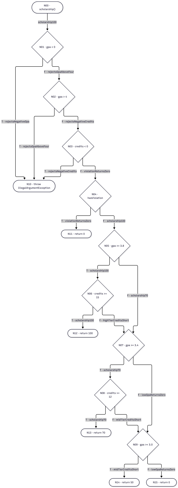

# Лаборатори 9 — JaCoCo кодын хамралт

**Оюутан** Л.Мөнхжин  
**Оюутны код** B242270094

## Ажиллуулсан орчин

`java -version` болон `mvn -version` командын бүтэн гаралт

```text
openjdk version "17.0.18" 2026-01-20
OpenJDK Runtime Environment Homebrew (build 17.0.18+0)
OpenJDK 64-Bit Server VM Homebrew (build 17.0.18+0, mixed mode, sharing)

Apache Maven 3.9.12 (848fbb4bf2d427b72bdb2471c22fced7ebd9a7a1)
Maven home: /opt/homebrew/Cellar/maven/3.9.12/libexec
Java version: 17.0.18, vendor: Homebrew, runtime: /opt/homebrew/Cellar/openjdk@17/17.0.18/libexec/openjdk.jdk/Contents/Home
Default locale: en_MN, platform encoding: UTF-8
OS name: "mac os x", version: "26.3.1", arch: "aarch64", family: "mac"
```

`mvn clean verify` командаар тестүүдийг ажиллуулж, JaCoCo-ийн HTML тайланг `target/site/jacoco/index.html` файлд үүсгэнэ.

## A — Хэвийн урсгалын эхний хэмжилт

| Үе шат | Амжилттай тест | Мөрийн хамралт | Салааны хамралт |
| --- | ---: | ---: | ---: |
| A | 5 | 16/25 (64%) | 22/41 (53.7%) |
| B | 17 | 25/25 (100%) | 41/41 (100%) |
| D засварын дараа | 26 | 25/25 (100%) | 41/41 (100%) |

Хувийг хамрагдсан тоог хамрагдсан ба хамрагдаагүй тооны нийлбэрт хувааж тооцов. [A шатны JaCoCo CSV](results/jacoco-A.csv) · [Maven гаралт](results/mvn-verify-A.txt)

Шар ромботой 20, 31, 48-р мөрөнд оролт шалгах нөхцөлүүдийн хүчинтэй замаар орсон тул алдаатай оролтын салаанууд дутуу үлдсэн. Мөн 25-р мөрөнд `score >= 70` нөхцөлийн худал салаа, 36-р мөрөнд `switch`-ийн `C`, `D`, `default` салаа, 51–53-р мөрөнд сахилгын зөрчил болон тэтгэлгийн босгын зарим салаа хамрагдаагүй. Улаанаар тэмдэглэгдсэн 21, 32, 49-р мөрийн exception шидэх хэсгүүд болон 54, 55-р мөрийн 50 хувь, үндсэн 0 хувь буцаах замуудад тест хүрээгүй.

## B — Удирдлагын урсгалын график ба бүрэн хамралт

`scholarship()`-ийн графикт `||` болон `&&`-ийн богино холболтыг тусдаа зангилаагаар дүрсэлж, ирмэг бүрд түүнийг дайрсан нэг тестийн методын нэрийг тэмдэглэв.



Бүрэн хамралтад хүрэхэд нийт 17 тест шаардагдсан. `gpaAllGrades` нь `switch`-ийн `default` салаагаар `F` дүнг 0 оноогоор тооцохыг хамарсан. `highTierCreditsShort` ба `midTierCreditsShort` тестүүд голч хүрсэн ч кредит дутсан замуудыг шалгасан. `rejectsNegativeGpa`, `rejectsGpaAboveFour`, `rejectsNegativeCredits` нь шалгалтын гурван нөхцөл тус бүрд `assertThrows` ашигласан.

`BRANCH_MISSED = 0`, `LINE_MISSED = 0`. [B шатны JaCoCo CSV](results/jacoco-B.csv) · [Maven гаралт](results/mvn-verify-B.txt)

## C — Давталтын зааг

| Давталтын тоо | Оролт ба хүлээгдсэн үр дүн | Тестийн метод |
| --- | --- | --- |
| 0 | Хоосон массив болон `null` оролт тус бүр `IllegalArgumentException` шиднэ | `gpaRejectsEmptyScores`, `gpaRejectsNullScores` |
| 1 | `[95]` массивын голч `4.0` | `gpaWithOneScore` |
| 2 ба түүнээс дээш | `[95, 85, 75, 65]` массивын голч `2.5` | `gpaWithMultipleScores` |

Хоосон массив болон `null` оролтыг B шатанд шалгасан бөгөөд C шатанд нэг болон олон дүнтэй тохиолдлыг нэмж, JaCoCo-ийн мөр, салааны тоо хэвээр байгааг баталгаажуулсан. Эдгээр тест тус тусдаа хоосон оролтыг зөв татгалзах, ганц дүнгийн голчийг зөв буцаах, олон дүнг хуримтлуулж массивын уртад зөв хуваах зан төлөвийг батална.

## D — 60 онооны заагийн алдаа

`letterGrade()`-ийг `60`, `59.99`, `69.99`, `0`, `100`, `89.99`, `90` утгаар шалгахад `gradeAt60` ганцаараа унасан. [Засварын өмнөх Maven гаралт](results/mvn-test-D-fail.txt)

```text
[ERROR]   ScholarshipCalculatorTest.gradeAt60:35 expected: <D> but was: <F>
```

`score > 60` нөхцөлийг `score >= 60` болгосон. [Эцсийн JaCoCo CSV](results/jacoco-final.csv) · [Maven гаралт](results/mvn-verify-final.txt)

### Дүгнэлт

JaCoCo нөхцөлийн үнэн, худал салаа ажилласан эсэхийг хэмждэг. `score > 60` болон `score >= 60` нөхцөл хоёул үнэн ба худал гэсэн ижил бүтэцтэй салаа үүсгэнэ. B шатны тестэд 65 ба 55 оноо хоёр нөхцөлд адил үр дүн өгсөн тул салааны хамралт 100% хүрсэн ч 60 онооны алдаа үлдсэн. `gradeAt60` тест яг зааг дээр буцаасан дүнг спецификацитай тулгаж зөрүүг илрүүлсэн. Хамралтын тайлангаар аль замыг ажиллуулсныг мэдэж, зааг утгын тестээр тухайн замын үр дүн зөв эсэхийг шалгана.

## AI туслахын хэрэглээ

Codex-оор JUnit тестүүдийг бичиж, Maven болон JaCoCo-г үе шат бүрд ажиллуулж, гаралтыг хадгалсан. Мөн `scholarship()`-ийн CFG-г дижитал байдлаар зурж, тестийн нэрсийг тулган, 60 онооны нөхцөлийг засаж, README-г боловсруулсан.

## Засварын коммит

`4bf837c`
